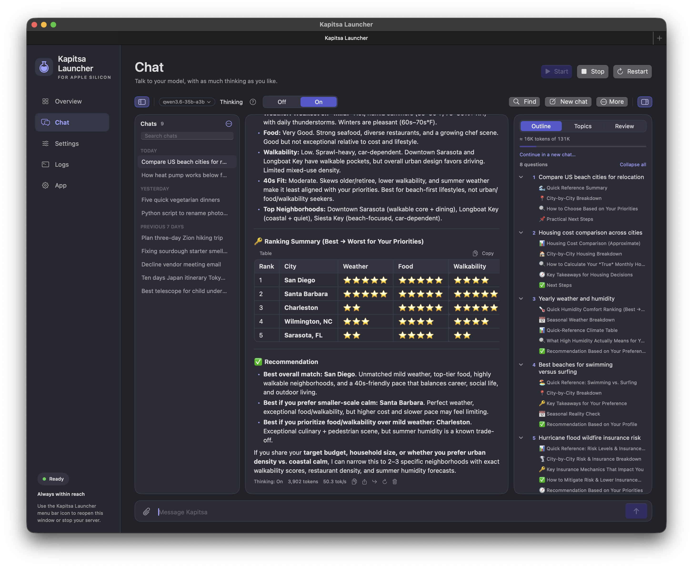
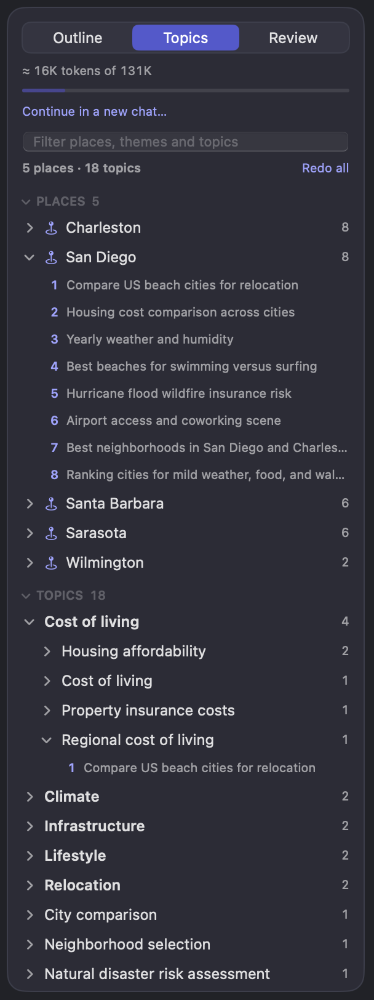
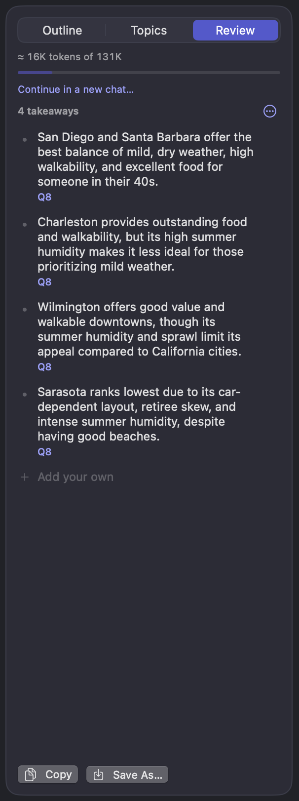
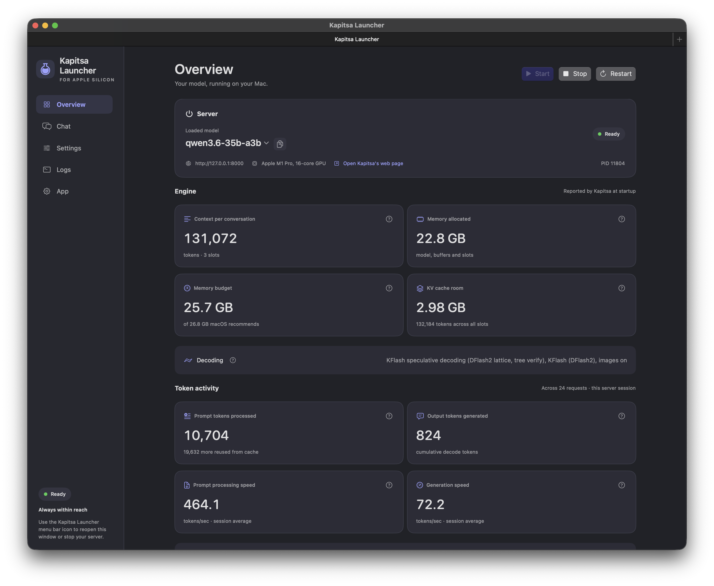

# Kapitsa Launcher

A native macOS app for running a local [Kapitsa](https://github.com/nace-ai/kapitsa) model
server and chatting with it, without the command line.

> **Unofficial.** Kapitsa Launcher is an independent project. It is not made by,
> affiliated with, or endorsed by the developers of Kapitsa. It controls an existing
> Kapitsa installation and never installs, updates or modifies Kapitsa itself.



## What it does

- **Takes care of running Kapitsa.** Start, stop or restart the server with one click,
  and pick a different model from a menu. The first time a model downloads, you can
  watch its progress. Closing the window doesn't lose it either; an icon in the menu bar
  keeps it one click away.
- **Lets you chat with your model.** Replies stream in as they're written, with proper
  formatting for Markdown, tables and code. While the model is thinking you can follow
  along, and once the answer starts, its thinking folds away so it doesn't clutter the
  reply. The thinking levels on offer match whichever model you're running.
- **Keeps your chats organised.** Saved chats are grouped by date, and you can search them
  by anything that was said, not just their titles. Each window or tab holds its own chat,
  so you can keep several going at once.
- **Helps you find your way around a long chat.** A side panel gives you three views:
  - **Outline:** every question you asked, with the headings from each reply. Click any
    of them to jump straight there.
  - **Topics:** the places and themes the chat covered, each linked back to the questions
    where they came up.
  - **Review:** takeaways the model pulls from the conversation. You can edit them, pin
    the ones that matter, or add your own.
- **Lets you explore without losing your thread.** Ask a side question about any reply
  without derailing the main conversation. Edit a question and send it again. Or ask for
  another answer and flip between the versions to compare.
- **Exports to Markdown.** You can include a summary written by the model, and the places
  and themes come along as tags, ready for note apps like Obsidian.
- **Shows what the server is doing.** See which model is loaded, how much memory it's
  using, how much context is left, token speeds, and the server's own log.

<p>
  
  &nbsp;
  
</p>



## Install

1. **Install Kapitsa**, for example with Homebrew:

   ```bash
   brew install nace-ai/tap/kapitsa
   ```

   If Kapitsa Launcher can't find `kapitsa`, it says so and links to the project page.
2. **Build Kapitsa Launcher** with Xcode 15.3 or later, or the Command Line Tools:

   ```bash
   zsh Scripts/build-app.zsh
   open "dist/Kapitsa Launcher.app"
   ```

3. **Press Start.** The first start downloads the model, which can take a while; the
   Overview shows the progress.

## Requirements

- An Apple silicon Mac with macOS 14 or later.
- Kapitsa 0.2 or later. The launcher looks for `kapitsa` in `/opt/homebrew/bin` and
  `~/.local/bin`, or you can choose it in Settings.

## Privacy and safety

- **Everything stays on your Mac.** The server listens on `127.0.0.1:8000`, so only this
  Mac can connect, unless you change the host in Settings.
- **It only stops what it started.** A Kapitsa server started some other way, such as the
  Homebrew service, is never stopped.
- **No shell.** Kapitsa is launched directly with a fixed list of arguments.
- **Keys stay hidden.** An optional API key is kept in the macOS Keychain and hidden in the
  log.
- **Your chats are files you own,** one JSON file per chat in
  `~/Library/Application Support/KapitsaLauncher/Chats/`.

## Development

`Scripts/build-app.zsh` builds a release binary and packages it as
`dist/Kapitsa Launcher.app`, ad-hoc signed for local use. `swift build` and `swift test`
compile and test the code but don't update the app bundle. The tests need full Xcode,
because the Command Line Tools don't include XCTest.

```bash
swift test
```

## Credits

The mark, a flask of superfluid helium whose surface climbs the glass, is drawn in code from
a single source, [`KapitsaMark.swift`](Sources/KapitsaLauncher/KapitsaMark.swift), which
produces the app icon, the sidebar mark and the menu bar symbol.

## License

[MIT](LICENSE)
